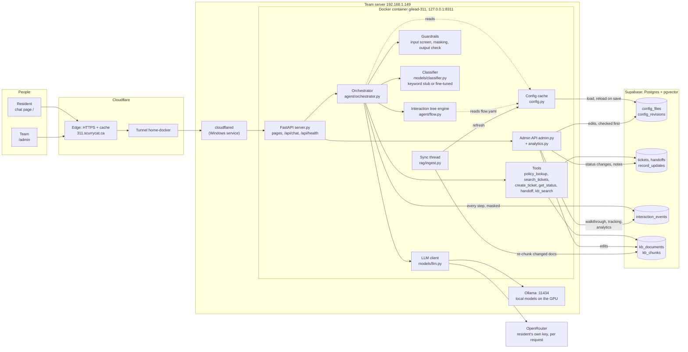
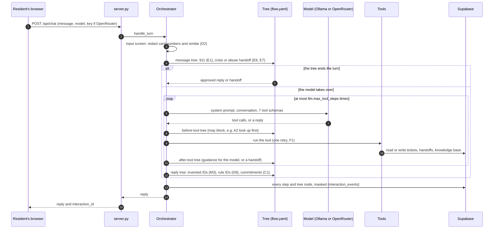

# Architecture

How the whole site runs, from a resident's message to the database and back.
The diagrams are Mermaid: GitHub draws them as pictures. A fuller swim-lane
version (each step, the rules it applies, and how the team changes the
site) is [architecture_diagram.html](architecture_diagram.html); open it in
a browser.

## The whole system

What runs where:

| Piece | Where | Notes |
|---|---|---|
| Pages and API | Docker container on the team server | `docker compose up -d --build`; published on `127.0.0.1:8311` only |
| Public address | Cloudflare | `311.scurrycat.ca` is a route on the existing `home-docker` tunnel; no router ports open |
| Local models | Ollama on the host, outside the container | reached at `host.docker.internal:11434`; up only while the `yick1` session is logged in |
| Cloud models | OpenRouter | the resident pastes their own key; it lives in the page's memory, travels with each request and is never stored or logged |
| Everything else | Supabase | config, tickets, handoffs, the event log and the knowledge base; the container keeps no files |

## One chat turn

## How the team changes the site

| /admin tab | Reads | Writes |
|---|---|---|
| Interactions | `interaction_events`, `handoffs`, `tickets` | nothing |
| Tickets, Handoffs | `tickets`, `handoffs`, `record_updates` | status and notes (`record_updates`) |
| Flow | `flow.yaml` | `flow.yaml`, checked before it goes live |
| Files | `config_files`, `config_revisions` | any config file, checked first, every version kept |
| Knowledge base | `kb_documents` | documents; changed ones are re-chunked at once |
| Analytics | `interaction_events` (no flow traces), `tickets` | the `costs` block of `app.yaml` |

Only code changes need a deploy (`git pull`, `docker compose up -d --build`).
Policy, prompts, guardrails, the tree, the knowledge base and the cost
assumptions take effect on the next message.

## Configuration lives only in Supabase

Every file the agent reads (`app.yaml`, `policy.yaml`, `guardrails.yaml`,
`flow.yaml`, `prompts/...`) is a row in Supabase `config_files`; every save
is kept in `config_revisions`. The repo has no copy for the site to fall
back on, so nothing goes stale. `src/config.py` loads them once, keeps them
in memory, and:

- reloads at once when `/admin` saves a change (new conversations use it;
  conversations already open keep the system prompt they started with);
- picks up edits made straight in the Supabase table within
  `retrieval.sync_interval_s` (the server's sync thread);
- keeps using the last version loaded if Supabase is briefly unreachable.
  If it was never loaded, `/api/chat` answers 503 and `/api/health` reports
  `config: unavailable`.

The tests and offline runs (`USE_MEMORY_STORE=1`) use the in-memory store,
which starts from `tests/fixtures/config/`. The site never reads that
folder. `python run.py config pull tests/fixtures/config` refreshes it from
Supabase; `python run.py config push <dir>` seeds a new Supabase project.

## The interaction tree

`flow.yaml` is the operating policy's decision logic as data. The
orchestrator runs one tree at each fixed point of a turn (a "hook"):

| Hook | When | Default tree (rules) |
|---|---|---|
| `message` | a resident message arrives, after D2 redaction | D2 log, E1 911, E8 crisis + handoff, E7 handoff, S1 note to the model |
| `after_classifier` | the classifier ran on a resident message (in code, before the model) | E3 unsure: ask one clarifying question, hand off if still unsure |
| `after_search_tickets` | search returned | C6 duplicate found: use the duplicate wording, don't file a second |
| `before_create_ticket` | before creating | A4 already handed off, A8 one ticket, A2 look up first (block) |
| `after_create_ticket` | create returned | M3 confirm with the exact ID; A4 missing fields: M2 ask one, E6 hand off past the limit |
| `before_get_status` | before a status lookup | D5 both ticket number and postal code (block) |
| `tool_failure` / `model_failure` | still failing after one retry | E9 tool-failure wording + handoff |
| `step_limit` | no answer in `llm.max_tool_steps` | M4 handoff |
| `reply` | the model wrote a reply | D8 strip rule IDs, M3 invented ID / false ticket claim: block + handoff, C1 flag |

A node is a **decision** (`check` + params, `yes` / `no` branches; a missing
branch carries on) or an **action** (`continue`, `guide` the model, `flag`,
`strip_rule_ids`, or `reply` / `handoff` / `block`, which end the hook).
`enabled: false` switches a node off. The checks and actions are the
vocabulary in `src/agent/flow.py`; the tree decides how they are wired, so
policy owners can reorder, rewire, reword and switch steps off without code.
A new kind of check needs code.

Every node visited is logged as a `flow` event: the node, what the check
saw (`observed`), the branch taken, and the rule ID when it fired. `/admin`
replays a conversation step by step with the tree beside it and the path
highlighted.

Guardrails on edits: a tree save is refused if it points to a missing node,
loops, uses an unknown check or action, or leaves a [hard] rule (E1, A2, A8,
D5, E6, E9, M3) without a switched-on action that the agent can reach.
D2 redaction and D6 masking always run in code and can't be switched off.

`src/agent/rules.py` keeps the conversation facts the checks read (codes
looked up, tickets and IDs returned, attempts per missing field, times the
classifier was unsure).

## One turn

1. **Input screen** (`src/guardrails/input_screen.py`) redacts D2 items and
   records which pattern lists matched. Then the `message` tree runs; a
   `reply` or `handoff` there ends the turn without calling the model.
2. **Model loop.** The selected LLM gets the system prompt
   (`prompts/agent/...`) and the seven tools. Each tool call runs the
   `before_<tool>` tree (may block it), the tool (one retry, F1), then the
   `after_<tool>` tree (may hand off, or add `guidance` to the result the
   model sees). At most `llm.max_tool_steps` round trips.
3. **Reply.** The `reply` tree checks the model's reply before the
   resident sees it.
4. **Logging.** Every model call, tool call (arguments and result), tree
   node and the final reply go to `interaction_events` with masked text,
   tokens, latency and cost.

## State

Conversation state (messages, rule state) is kept in server memory keyed by
`interaction_id` and expires after `agent.session_ttl_minutes`. The
OpenRouter key is not part of that state: it arrives with each request and
is dropped after the call. Everything else lives in Supabase.

## Retrieval

`kb_search` calls the `match_kb_chunks` RPC. Full-text search
(Postgres `tsvector`) always runs; when `retrieval.embedding_provider` is
`ollama`, a pgvector cosine search runs too and the two rankings are fused
with reciprocal rank fusion. The policy store is NOT in the knowledge base:
routing, required fields and escalation triggers come only from
`policy.yaml` via `policy_lookup`.

The knowledge base lives only in Supabase (`kb_documents`). The server's
sync thread (`src/rag/ingest.py` `start_sync`) re-chunks new and edited rows
every `retrieval.sync_interval_s` seconds; `active = false` hides a document
at once.

## Analytics

`/admin` > Analytics (`src/web/analytics.py`) reads the event log live. It
buckets conversations by hour, day or month in the viewer's time zone (days
and months follow the local calendar, so a DST day has 23 or 25 hours), and
prices each period:

- **Model:** the `cost_usd` logged with each call. OpenRouter returns the
  real price; local Ollama calls are free unless
  `costs.ollama_per_million_tokens` is set.
- **Hosting:** `costs.hosting_per_month`, prorated by the hours in the
  period (up to now for the current one).
- **Staff review:** each handoff times `costs.review_time_s` at
  `costs.labour_rate_per_hour`.
- **By hand:** each request times `costs.manual_handle_time_s` at the same
  rate, for comparison (metrics doc: 312 s at $35 to $55 an hour).

**Model speed** compares models on the same live traffic: per model, the
median and 95th percentile of the whole reply (resident message to agent
reply, the G10 measure), of one model call alone, output tokens per second
and model calls per reply. A turn counts toward the model that answered it;
turns the tree answered on its own are shown apart as a baseline. Ollama
times are local GPU inference; OpenRouter times include the internet round
trip.

G9 (cost per *successful* intake) also divides by the success rate, which
only the eval harness measures, so the tab shows cost per request and per
ticket filed instead.

## Re-runs

`/admin` > Interactions > *Re-run with another model or classifier* replays a
logged conversation on another model and/or classifier (`src/agent/rerun.py`)
so the team can compare them on real requests. The classifier defaults to the
original's, so changing only one of the two isolates its effect. Analytics >
Re-runs shows each original and its re-runs side by side, turn by turn,
including each turn's classifier code and confidence, pooled by model and by
classifier.

## Classifiers

The route classifier runs in code on each resident message, before the
model, until the request's code is settled (`src/models/classifier.py`,
`_classify` in the orchestrator). Which one is a setup name from
`src/eval/setups.yaml`: the keyword stub or a fine-tuned model loaded from
`src/models/fine_tuning` (gitignored; mounted into the container). The chat
page's model panel picks it per conversation, re-runs pick it per run, and
`app.yaml` `agent.classifier` sets the default. Each run is a `classifier`
event (setup, code, confidence, time), which Analytics > Classifiers sums
per setup: unsure rate, confidence bands, time, and agreement with the code
the conversation settled on.

- **What is replayed:** the resident's messages as logged. Logs are masked
  (D6), so each mask tag gets a fixed stand-in (`[STREET_NUMBER]` becomes
  `100`, `[PHONE]` becomes `555-0100`); `[REDACTED]` stays. The resident's
  later messages answered the original agent, so they may not fit a re-run
  that asked something else. Re-running on the original model gives the
  like-for-like baseline.
- **No side effects:** the re-run's thread uses `ReplayStore`, set with a
  context variable in `src/tools/store.py` so live chats are unaffected.
  `create_ticket` and `handoff` return simulated IDs from a reserved range
  (`311-YYYY-9xxxxx`, `HO-YYYY-9xxxxx`) and write nothing; `search_tickets`
  only sees tickets opened before the original conversation, so the
  original's own ticket doesn't turn up as a duplicate. Status lookups, the
  knowledge base, config and the event log are live.
- **Marking:** the re-run's first event is `rerun` with `{"of": original,
  "model": label}`. Analytics leaves re-runs out of usage and cost.
- **Comparing decisions:** a turn "took the same decisions" when it called
  the same tools in the same order and fired the same rules as the
  original's turn.
- At most two re-runs run at once (the GPU also serves the live site). An
  OpenRouter key comes with the request, lives only in that job while it
  runs, and is never stored or logged.
